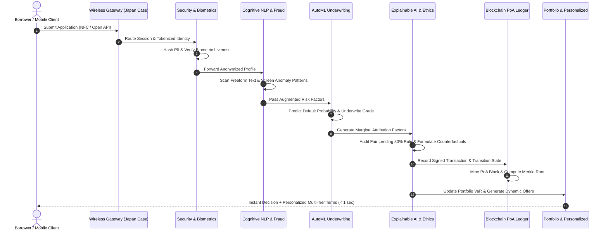

# NexusFin AI - Architectural Blueprint & System Design

This document details the multi-tier architectural blueprint of the **NexusFin AI** Banking and Financial Intelligence Platform, mapping software services to modern financial engineering paradigms and regulatory standards.

---

## 1. High-Level System Architecture

The platform operates as a modular, event-driven micro-architecture divided into six decoupled layers:

```
+-----------------------------------------------------------------------------------+
|                           1. PRESENTATION & INTEGRATION LAYER                      |
|  [REST API (Port 5050)]   [Interactive HTML Dashboard]   [Unified CLI Interface]  |
|  [Japan Wireless Banking Gateway: NFC FeliCa / NTT DOCOMO / Seven Bank Open API]  |
+-----------------------------------------------------------------------------------+
                                         |
                                         v
+-----------------------------------------------------------------------------------+
|                        2. ORCHESTRATION & INGESTION LAYER (RPA)                   |
|  [RPA Document Extraction Bot]  -->  [Straight-Through Processing (STP) Engine]   |
|  [Schema Validator & Imputer]   -->  [PII Tokenizer & Access Controller (RBAC)]   |
+-----------------------------------------------------------------------------------+
                                         |
                                         v
+-----------------------------------------------------------------------------------+
|                         3. INTELLIGENCE & ANALYTICS LAYER                         |
|  +---------------------------+  +---------------------------+                     |
|  | Biometric Verification    |  | Cognitive NLP Underwriter |                     |
|  | Cosine Matching & Liveness|  | Sentiment & Intent Mining |                     |
|  +---------------------------+  +---------------------------+                     |
|  +---------------------------+  +---------------------------+                     |
|  | Fraud & Anomaly Screening |  | AutoML Credit Scorer      |                     |
|  | Synthetic ID & Outliers   |  | Logistic / GBDT Ensembles |                     |
|  +---------------------------+  +---------------------------+                     |
|  +---------------------------+  +---------------------------+                     |
|  | Explainable AI (XAI)      |  | Trust & Ethics Auditor    |                     |
|  | Local Shapley & Guidance  |  | EEOC 80% Disparate Impact |                     |
|  +---------------------------+  +---------------------------+                     |
+-----------------------------------------------------------------------------------+
                                         |
                                         v
+-----------------------------------------------------------------------------------+
|                      4. FINANCIAL ENGINEERING & ALLOCATION LAYER                  |
|  [Modern Portfolio Theory: Markowitz Simplex Optimizer (Sharpe Ratio Tangency)]   |
|  [Portfolio Credit Risk: Parametric VaR (95%/99%), Expected Shortfall (CVaR)]     |
|  [Macro Stress Testing: Baseline, Mild Recession, Severe Stagflation Scenarios]   |
|  [Personalized Banking: Dynamic Risk APR Pricing, 3-Tier Payoff, Hardship Relief] |
+-----------------------------------------------------------------------------------+
                                         |
                                         v
+-----------------------------------------------------------------------------------+
|                      5. QUANTUM & DECENTRALIZED TRUST LAYER                       |
|  [Quantum Amplitude Estimation: O(1/eps) Quadratic Speedup over Monte Carlo]      |
|  [QAOA Quantum Combinatorial Portfolio Knapsack Optimization]                     |
|  [Post-Quantum Cryptography: NIST Lattice-Based Migration Roadmap]                |
|  [Consortium Blockchain: Proof-of-Authority (PoA) Smart Contract Audit Ledger]    |
|  [Merkle Tree Root Validation & Tamper-Proof Application State Transitions]       |
+-----------------------------------------------------------------------------------+
                                         |
                                         v
+-----------------------------------------------------------------------------------+
|                             6. DATA & SECURITY VAULT                              |
|  [LendingClub Master Data Vault]  [Epsilon-Differential Privacy (Laplace Noise)]  |
|  [Salted SHA-256 Hashing Vault]   [JSON Configuration & Regulatory Policy Store]  |
+-----------------------------------------------------------------------------------+
```

---

## 2. Component Interaction & Straight-Through Processing (STP) Flow

When a borrower or credit channel submits an application, the straight-through processing flow executes deterministically within milliseconds:



---

## 3. Data Schema & Engineering Standards

The platform processes the standard US LendingClub schema consisting of:
- **Financial Ratios**: `dti` (debt-to-income), `annual_inc`, `revol_util`, `installment`, `loan_amnt`.
- **Credit Bureau Metrics**: `fico_range_high`, `fico_range_low`, `delinq_2yrs`, `inq_last_6mths`, `open_acc`, `total_acc`, `pub_rec`.
- **Borrower Signals**: `emp_length`, `home_ownership`, `verification_status`, `purpose`, `title`, `desc`.
- **Output States**: `loan_status` (Fully Paid, Charged Off, Default, Current).
